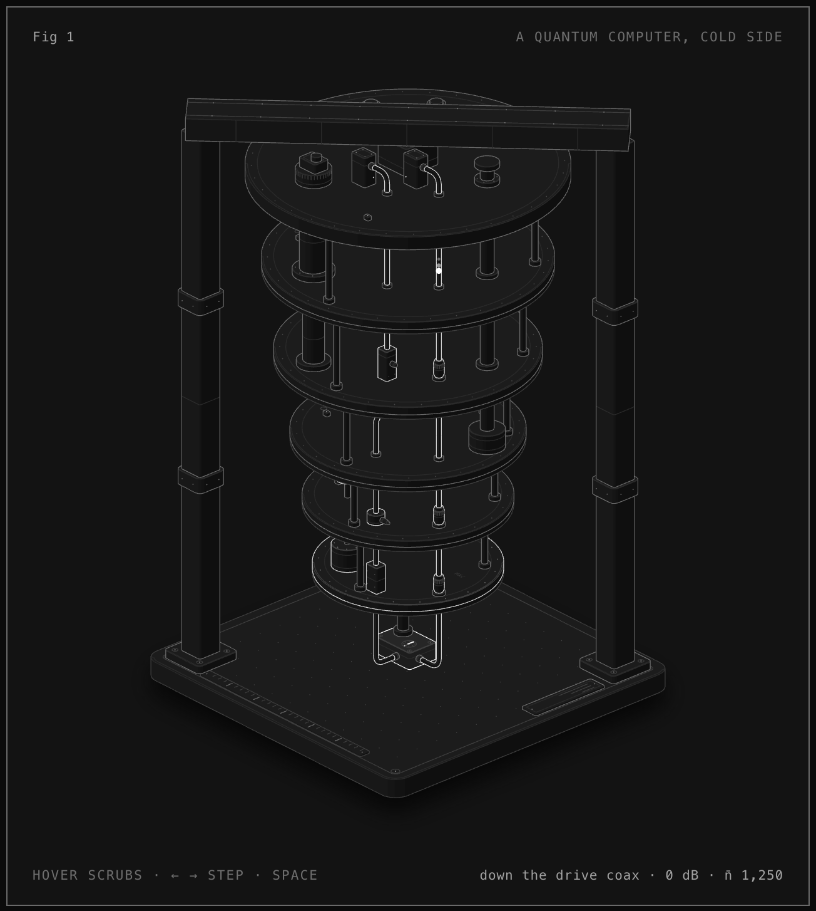

# A quantum computer

An interactive isometric cutaway of a superconducting quantum computer: the gold "chandelier" you see in every lab photo, with the qubit chip at the bottom.

**Open it:** https://rudrajmehta.github.io/anatomy-quantum-computer/ (dark) · [light](https://rudrajmehta.github.io/anatomy-quantum-computer/quantum-computer-light.html)



## What it shows

A microwave pulse leaves room temperature and travels down the drive coax. Each stage's attenuator takes its bite (20 dB at 4 K, 20 dB at the cold plate, 20 dB at the mixing chamber, 60 dB in all), so a line that carries about 1,250 thermal photons per mode at 300 K delivers about 0.003 at the chip. The pulse flips the qubit (a 20 ns X gate). The readout signal climbs back up through two isolators at the mixing chamber, a circulator at the cold plate, the HEMT amplifier at 4 K and a room-temperature amplifier. Then the qubit decays with T1 = 85 µs.

| Stage | Temperature in the figure |
|---|---|
| 50 K plate | 35 K |
| 4 K plate | 2.85 K |
| Still | 882 mK |
| Cold plate | 82 mK |
| Mixing chamber | 14 mK |

Every number in the live readout comes from `model.mjs`. Sources for each one are in [NOTES.md](NOTES.md), mainly Krinner et al., "Engineering cryogenic setups for 100-qubit scale superconducting circuit systems", EPJ Quantum Technology 6:2 (2019), and Kjaergaard et al., "Superconducting Qubits: Current State of Play" (2020). Corrections welcome as issues.

## Controls

Hover to scrub through time, Left and Right to step, Space to pause, Escape to resume. Reduced motion shows a still frame.

## Rebuild

```bash
node build.mjs          # quantum-computer.html
node build.mjs --light  # quantum-computer-light.html
node build.mjs --audit  # geometry audit: clearances, depth order, terminals
```

Needs Node 20.10+. Video and capture commands are in NOTES.md (they need Chrome and ffmpeg).

## Credits

Built with Claude Code and the [Anatomy](https://github.com/wheresryan22/anatomy) skill by Ryan (@wheresryan22). The drawing kit in `kit/` is Anatomy's, MIT, © 2026 Ryan, with its license in `kit/LICENSE`. The figure, model and build script are MIT, © 2026 Rudraj Mehta.
